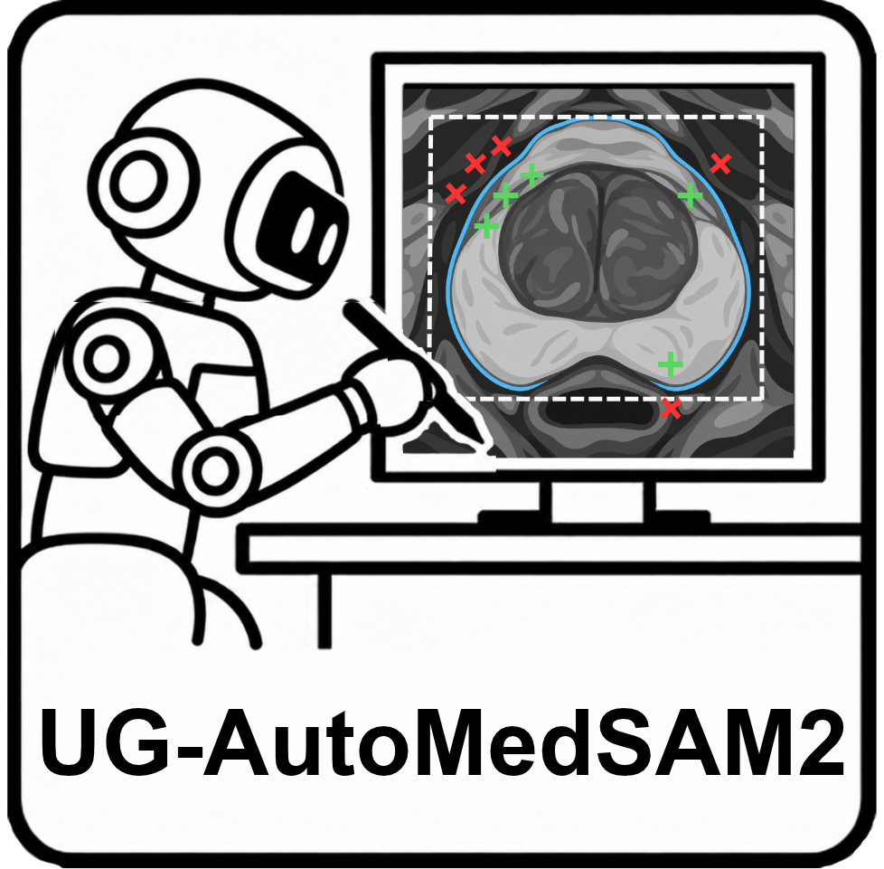

<p align="center">
  
</p>

<h1 align="center">UG-AutoMedSAM2</h1>

<p align="center"><strong>Uncertainty-guided, self-prompted MedSAM2 for prostate contour refinement.</strong></p>

UG-AutoMedSAM2 explores whether predictive uncertainty can guide automatic prompting of [MedSAM2](https://github.com/bowang-lab/MedSAM2) to refine existing prostate clinical target volume (CTV) contours. The intended application is to support clinicians and reduce manual editing burden in MR-Linac adapt-to-shape workflows.

## Method overview

The pipeline processes an MRI volume as a sequence of axial slices:

1. **Load inputs:** MRI, an initial segmentation, and its uncertainty map.
2. **Construct an uncertainty envelope:** threshold the uncertainty map using a target envelope width or a fixed threshold.
3. **Generate prompts:** Creation of three prompting strategies, consisting of coarse mask prompts, staple prompts, or uncertainty-guided bounding boxes.
4. **Run MedSAM2:** propagate predictions through the volume for each configured prompt strategy.
5. **Fuse predictions:** combine strategy logits via weighted aggregation.
6. **Evaluate:** compare predictions with a reference segmentation or a consensus derived from observer recontours.

The implementation was initially tested using binary mask prompts, but has been tweaked to support non-binary mask prompting to facillitate future research.

## Repository contents

| File or directory | Purpose |
| --- | --- |
| [`LUNDPROBE_inference.ipynb`](LUNDPROBE_inference.ipynb) | Step-by-step inference and evaluation notebook. |
| [`DataLoader.py`](DataLoader.py) | Load LUND-PROBE images, masks, uncertainty maps, and observer recontours. |
| [`unc_handling.py`](unc_handling.py) | Construct uncertainty envelopes and generate prompts through `UG_prompter`. |
| [`uncertainty_util.py`](uncertainty_util.py) | Contour tracing, envelope thickness estimation, and prompt validity checks. |
| [`segmentation.py`](segmentation.py) | Configure MedSAM2, prepare mask prompts, run prompt strategies, and fuse predictions. |
| [`segmentation_util.py`](segmentation_util.py) | Image preprocessing, propagation, prompt combination, and consensus generation. |
| [`evaluation.py`](evaluation.py) | Volume-level and slice-level segmentation metrics. |
| [`sam2/`](sam2/) | SAM2/MedSAM2 model implementation and configurations. |
| [`efficient_track_anything/`](efficient_track_anything/) | Included EfficientTAM implementation. |
| [`training/`](training/) | Included training utilities; not required for the inference example below. |
| [`checkpoints/`](checkpoints/) | Location for separately downloaded model weights. |

## Installation

Use Python **3.10 or newer** in a dedicated environment. The package requires PyTorch **2.5.1 or newer** and torchvision **0.20.1 or newer**. For GPU inference, install a compatible CUDA-enabled PyTorch build for your system using the [official PyTorch instructions](https://pytorch.org/get-started/locally/).

```bash
git clone https://github.com/JorisMentink/UG-AutoMedSAM2.git
cd UG-AutoMedSAM2

python -m venv .venv
```

Activate the environment:

```bash
# Linux / macOS
source .venv/bin/activate
```

```powershell
# Windows PowerShell
.\.venv\Scripts\Activate.ps1
```

Install PyTorch and torchvision for your system first, then install the repository and notebook dependencies:

```bash
python -m pip install --upgrade pip setuptools wheel
python -m pip install --no-build-isolation -e .
python -m pip install jupyter matplotlib pandas ipywidgets
```

`setup.py` attempts to build an optional SAM2 CUDA extension. If you need to disable this build, set `SAM2_BUILD_CUDA=0` before running the editable installation (`export SAM2_BUILD_CUDA=0` on Linux/macOS, or `$env:SAM2_BUILD_CUDA="0"` in PowerShell). This can limit extension-dependent post-processing.

## Model checkpoint

Download `MedSAM2_latest.pt` using the instructions in the [original MedSAM2 repository](https://github.com/bowang-lab/MedSAM2), then place it at:

```text
checkpoints/MedSAM2_latest.pt
```

Model weights are not included. The `download.sh` mentioned in the checkpoint README is also not included; follow the upstream download instructions instead.

## Data preparation

The current loader expects the LUND-PROBE directory structure. For prostate CTV inference, each subject needs the following files, relative to the dataset root:

| Relative path | Contents |
| --- | --- |
| `<subject>/MR_StorT2/image.nii.gz` | MRI volume. |
| `<subject>/MR_StorT2/nnUNetOutput/mask_CTVT_427_nnUNet.nii.gz` | Unrefined deep-learning segmentation. |
| `<subject>/MR_StorT2/nnUNetOutput/mask_CTVT_427_nnUNet_uncertaintyMap.nii.gz` | Corresponding uncertainty map. |

`parentfolder` should point to the directory containing the subject folders. `subject_nr` is a zero-based index into the alphabetically sorted list of those folders, not a subject identifier.

For another dataset, adapt the paths in `DataLoader.py` while preserving these conventions. The loader implements prostate (`CTVT`) and rectum paths. Although `bladder` is accepted by its input check, its loading paths are not implemented.

## Acknowledgements and license

This work builds on [MedSAM2](https://github.com/bowang-lab/MedSAM2) and [SAM 2](https://github.com/facebookresearch/sam2), under the the [Apache License 2.0](LICENSE.txt). Consult the original sources for the terms applicable to separately obtained datasets and model weights.
